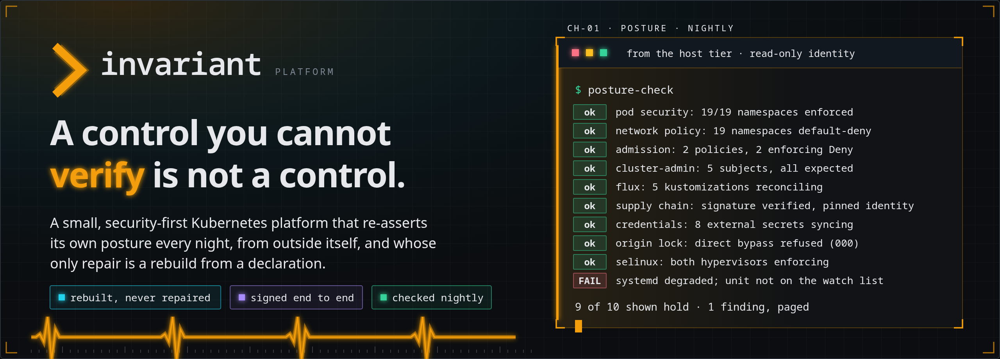
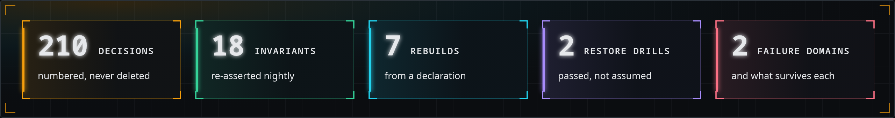
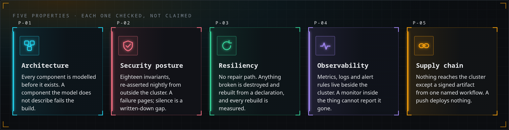
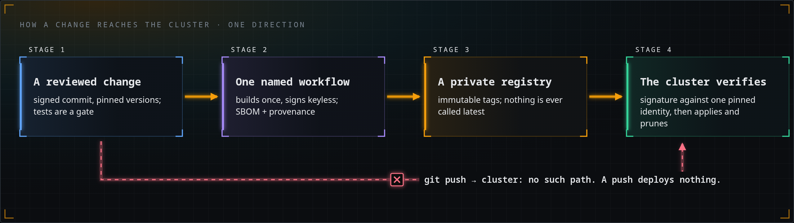
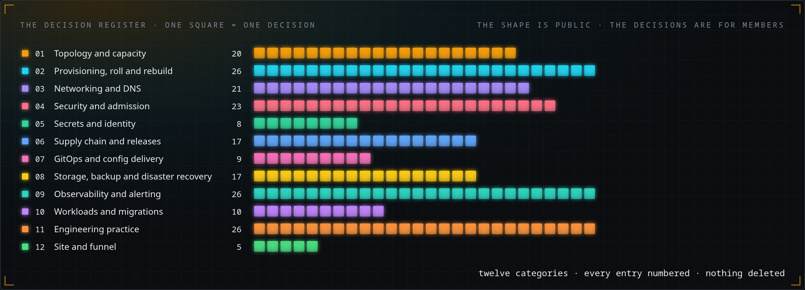
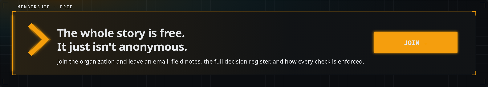

  <a href="https://invariant-platform.io"><picture><source srcset="https://raw.githubusercontent.com/InvariantPlatform/.github/main/profile/assets/hero.svg" type="image/svg+xml"></picture></a>

  <a href="https://invariant-platform.io"><b>invariant-platform.io</b></a> &nbsp;·&nbsp;
  <a href="https://invariant-platform.io/architecture/">Architecture</a> &nbsp;·&nbsp;
  <a href="https://invariant-platform.io/security-posture/">Security posture</a> &nbsp;·&nbsp;
  <a href="https://invariant-platform.io/resiliency/">Resiliency</a> &nbsp;·&nbsp;
  <a href="https://invariant-platform.io/observability/">Observability</a> &nbsp;·&nbsp;
  <a href="https://invariant-platform.io/supply-chain/">Supply chain</a> &nbsp;·&nbsp;
  <a href="https://invariant-platform.io/join/"><b>Join</b></a>

<picture><source srcset="https://raw.githubusercontent.com/InvariantPlatform/.github/main/profile/assets/stats.svg" type="image/svg+xml"></picture>

A property asserted in a document is not a property until something outside the system checks it, on a schedule, and pages when it stops being true. Invariant Platform is a small Kubernetes platform built on that rule: every claim on the site is one it checks, every night, from outside itself.

<picture><source srcset="https://raw.githubusercontent.com/InvariantPlatform/.github/main/profile/assets/pillars.svg" type="image/svg+xml"></picture>

<picture><source srcset="https://raw.githubusercontent.com/InvariantPlatform/.github/main/profile/assets/flow.svg" type="image/svg+xml"></picture>

<picture><source srcset="https://raw.githubusercontent.com/InvariantPlatform/.github/main/profile/assets/register.svg" type="image/svg+xml"></picture>

  <a href="https://invariant-platform.io/join/"><picture><source srcset="https://raw.githubusercontent.com/InvariantPlatform/.github/main/profile/assets/members.svg" type="image/svg+xml"></picture></a>

Built and run by <a href="https://www.bradpenney.io">Brad Penney</a>. Membership is free: no cost, no seat count, no card, and leaving is one click.

